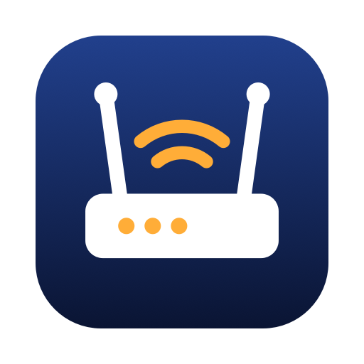

<p align="center">
  
</p>

<h1 align="center">WiFi or ISP</h1>

<p align="center">Is your slow internet your Wi-Fi or your ISP? A free, source-available menu bar app for macOS that tells you, and tells you what to do about it.</p>

<p align="center">
  <a href="https://wifiorisp.com">wifiorisp.com</a> ·
  <a href="https://github.com/coreyhaines31/wifiorisp/releases/latest">Download</a> ·
  <a href="https://wifiorisp.com/help">Help</a> ·
  <a href="https://github.com/coreyhaines31/wifiorisp/issues">Report a bug</a>
</p>

---

When the internet feels slow, WiFi or ISP measures both sides of the line at the same moment: the round trip to your router, and the round trip past it to the internet. If the router answers fast and the internet doesn't, it's your ISP. If even the router is slow, it's your Wi-Fi or your router. Then it tells you what to try, in order.

## Install

Requires macOS 14 Sonoma or later, on Apple Silicon or Intel.

**Download:** get the DMG from [Releases](https://github.com/coreyhaines31/wifiorisp/releases/latest), open it, and drag **WiFi or ISP** to Applications. It's signed and notarized by Apple, so it opens without warnings, and it updates itself.

**Or with Homebrew:**

```sh
brew install --cask coreyhaines31/tap/wifiorisp
```

### Or ask your AI agent

Paste this into Claude Code, Codex, or another coding agent:

```text
Install the macOS app "WiFi or ISP" for me.
If Homebrew is installed (check with `command -v brew`), run:
  brew install --cask coreyhaines31/tap/wifiorisp
Otherwise, download and install the signed DMG:
  curl -fL -o /tmp/WiFiOrISP.dmg https://github.com/coreyhaines31/wifiorisp/releases/latest/download/WiFiOrISP.dmg
  hdiutil attach -nobrowse -quiet -mountpoint /tmp/wifiorisp-dmg /tmp/WiFiOrISP.dmg
  ditto "/tmp/wifiorisp-dmg/WiFi or ISP.app" "/Applications/WiFi or ISP.app"
  hdiutil detach -quiet /tmp/wifiorisp-dmg
Then open it with: open -a "WiFi or ISP"
It's a menu bar app with no Dock icon. Tell me to look for the small router
icon near the clock, and that its welcome window asks about Location access
(only used to show the Wi-Fi network name) and opening at login.
```

## Your first two minutes

1. **Open WiFi or ISP** from Applications. There's no Dock icon and no window to look for: it lives in the menu bar, as a small router icon near the clock.
2. **A welcome window appears once.** It offers two things:
   - **Show your Wi-Fi network's name.** macOS treats network names as location data, so the app needs Location access to show yours. It never asks where you are, and everything else works without it ("Unknown network" is the only difference).
   - **Open at login,** so it keeps watching after a restart. On by default.
3. **macOS may ask two more questions** the first time they matter:
   - **"Find devices on your local network"** (macOS 15 and later): allow it. The app needs it to time your router. It doesn't look for or connect to anything else.
   - **Notifications:** allow them if you want to hear about drops, falling back to 2.4 GHz, or roaming to a weaker access point.
4. **Wait about 30 seconds.** The first verdict needs a few measurements.

Can't see the icon? On MacBooks with a notch, a crowded menu bar hides icons behind it. Hold ⌘ and drag other icons out of the way, or quit a few menu bar apps.

## Reading it

**The menu bar icon** is a little router. Its three lights show your Wi-Fi signal. When something is slow, the lights go dark and a word appears next to it: **WiFi**, **Router**, or **ISP**, whichever side is at fault. A slash through the router means you're not connected to any network.

**Click it** for the verdict and the numbers behind it:

| You see | It means | First thing to try |
| --- | --- | --- |
| Fine: WiFi and ISP both OK | Both sides answer quickly | Nothing. Run a lag test once to check calls won't stutter |
| Slow: weak WiFi signal | Even your router is slow, and the signal is weak | Move closer, or use the 5 or 6 GHz network |
| Slow: WiFi or router, not ISP | Strong signal, but the router is slow to answer | Restart the router, then try a quieter channel |
| Slow: ISP, not WiFi | Your router is quick; the internet past it isn't | Check your provider's outage page, then restart the modem |
| Offline: ISP is down, WiFi is fine | Your router answers; nothing past it does | Wait it out; the app logs when it started and ended |
| Offline: can't reach your router | Your Mac lost the router | Check the router is on, then move closer |

Under every verdict is **What to do**: a short list of next steps, tailored to your router's maker and your provider when the app can tell them. Each step opens the right guide, starts a test, or exports your report. If the app finds a limit no setting can fix (a router older than your Mac, Wi-Fi slower than your plan, no smart queueing to stop lag), it says so and links to what would.

## What else it does

- **History** (⌘H in the menu): signal and response times over the last hour to 30 days, with every drop marked.
- **Report for your ISP** (⌘E): a plain-text summary of outages and slowdowns, including whether your router kept answering during each outage, which is the evidence that puts it on their side. Or export everything as CSV.
- **Speed test:** against [M-Lab](https://www.measurementlab.net) (NDT7), only when you start it. M-Lab publishes every result as open data, and the app tells you that first.
- **Lag under load:** the IETF responsiveness test (the method behind Apple's `networkQuality`), with router probes during the test to show whether the lag builds up in your Wi-Fi or past your router.
- **Your Plan** (Settings): enter what you pay for and how your home uses the internet. The app compares your speed tests with your plan and tells you if the plan itself is too small.
- **Alerts:** when the internet drops and comes back, when your Mac falls to 2.4 GHz, or when it roams to a weaker access point.

## Privacy

- **No analytics, no account.** History stays on your Mac, in `~/Library/Application Support/WiFi or ISP/`.
- **Background traffic is tiny:** a TCP handshake to your router and to 1.1.1.1 and 8.8.8.8 every 5 to 30 seconds (no data is sent in them), plus one request to Cloudflare per network to learn which provider you're on.
- **Tests you start** talk to M-Lab (speed) and Cloudflare (lag under load).
- **Location access** is only used for the network name. The app never reads your location.

How the measurements and verdicts work, in detail: [docs/how-it-works.md](docs/how-it-works.md).

## Troubleshooting

**"Unknown network."** Location access isn't allowed. Click **Show Network Name…** in the menu, or turn on WiFi or ISP in System Settings → Privacy & Security → Location Services.

**Router "doesn't answer probes" or "Not measured."** Either your router ignores the probes (some do; the verdict then relies on signal and internet timing), or macOS blocked local network access. Check System Settings → Privacy & Security → Local Network, and turn WiFi or ISP on.

**It says "Wired" or ignores Wi-Fi.** Your Mac is sending traffic over Ethernet. That's measured too, without the signal readings.

**On a VPN.** Measurements still work and still time the Wi-Fi router underneath. Provider detection is skipped, because it would name the VPN.

**The speed test or lag test failed.** Both need the internet working. If it's down, the menu's verdict will say so.

**Something else?** [Open an issue](https://github.com/coreyhaines31/wifiorisp/issues/new/choose) with your macOS version and what the menu shows.

## Uninstall

Quit it from the menu, then drag it from Applications to the Trash. To remove its history and settings too:

```sh
brew uninstall --zap --cask wifiorisp   # if you installed with Homebrew
# or by hand:
rm -r ~/Library/Application\ Support/WiFi\ or\ ISP
defaults delete app.wifiorisp.WiFiOrISP
```

If it opens at login, turn that off first in its Settings → General, or afterwards in System Settings → General → Login Items.

## Build it yourself

You need Xcode 16 or later and [XcodeGen](https://github.com/yonaskolb/XcodeGen). No Apple Developer account required.

```sh
git clone https://github.com/coreyhaines31/wifiorisp.git
cd wifiorisp
brew install xcodegen swiftlint
Scripts/run-local.sh        # builds, signs to run locally, and opens the app
```

Or paste this into your coding agent:

```text
Clone https://github.com/coreyhaines31/wifiorisp and build it from source.
It needs Xcode 16 or later. Install XcodeGen and SwiftLint with Homebrew if
they're missing, then from the repo root run Scripts/run-local.sh, which builds
the app signed to run locally (no Apple Developer account) and opens it.
Then run the tests with: cd Packages/WiFiOrISPCore && swift test
Read CONTRIBUTING.md before changing any code.
```

Tests, the project layout, the developer CLI, and the website generator are covered in [CONTRIBUTING.md](CONTRIBUTING.md).

## License

WiFi or ISP is source available under the [Functional Source License, Version 1.1, MIT Future License](LICENSE) (FSL-1.1-MIT): use it, change it, and run it for anything except a competing product. Each version becomes MIT two years after it's released. The name and icon are covered by the [trademark policy](TRADEMARK.md).
